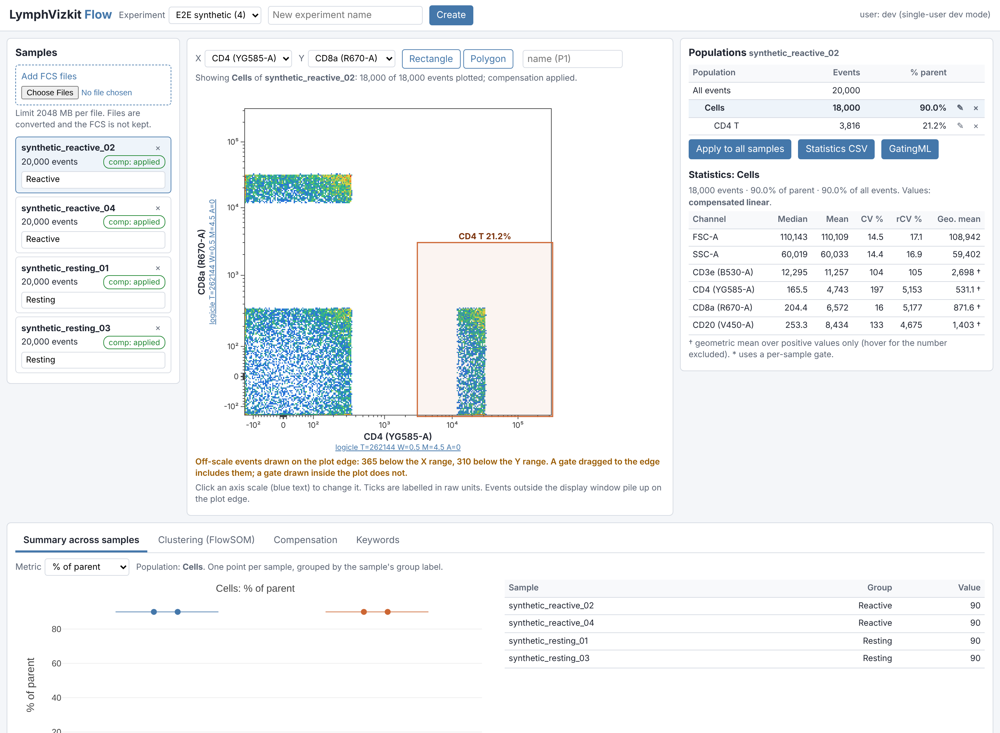

# OMIQ evaluation and an in-house flow cytometry workbench

Evaluation, roadmap and prototype notes, November 2026. Question asked: *what does the commercial
flow cytometry platform OMIQ offer, and which of its features could feasibly be built in the UF
Research Computing PubApps / HiPerGator environment that already hosts this app — separating
quick wins from extensive development?*

**Answer.** OMIQ is a cloud service that wraps roughly thirty published open-source cytometry
methods in one interface with shared, reproducible workflows. Its classical core (import,
compensation, scaling, gating, statistics, clustering) is a set of quick wins on open-source
libraries and fits the 2-vCPU PubApps VM; a working prototype of that core is in [`flow/`](../flow/)
and is verified against three independent references (§7). Multi-user operation, the R-based
algorithms and anything needing more than two cores are moderate to extensive work, and several
items are blocked on UFRC approvals rather than on code (§3, §5). At the academic list price OMIQ
is cheaper than building; building is justified only by data residency, event limits, HiPerGator
compute and integration with the imaging work here (§2).

Source caveat: the vendor and UFRC documentation hosts were not reachable from the session that
wrote this, so OMIQ and UFRC facts are taken from web-search extracts of those pages and each is
labelled by source type. Prices and plan limits must be confirmed with the vendor.

---

## 1. What OMIQ is

Cloud-only SaaS for classical and high-dimensional cytometry analysis; computation runs on the
vendor's cloud and is used through a browser. Acquired by Insightful Science (now Dotmatics) in
January 2022.

| Area | What OMIQ provides | Source / confidence |
|---|---|---|
| Import | FCS, CSV, FlowJo gating files (Essentials tier and up) | Vendor pricing page |
| Data types | Conventional, spectral, mass cytometry | GraphPad review (same parent company) |
| Classical tools | Compensation and unmixing, scaling, manual gating, gating hierarchy, backgating, report/figure building | Vendor features page |
| Autogating | Listed as a core tool; a method named "AdaptiGate" appeared in one homepage extract | Vendor; AdaptiGate **not corroborated** |
| Data cleaning | flowAI, flowCut, PeacoQC | Vendor features page |
| Batch normalisation | fdaNorm, gaussNorm, CytoNorm, cyCombine | Vendor features page |
| Dimensionality reduction | t-SNE, opt-SNE, UMAP, PCA, EmbedSOM, FIt-SNE, TriMap | Vendor (page several years old) |
| Clustering | FlowSOM, PhenoGraph, PARC, SPADE, ClusterX, CITRUS | Vendor |
| Trajectory | Wanderlust, Wishbone, Isomap, PHATE | Vendor |
| Differential analysis | diffcyt methods (2026 release notes); SAM (tutorial). edgeR **not confirmed** | Vendor |
| Export | Prism, CSV, PDF, FCS; direct GraphPad Prism hand-off | GraphPad integration page |
| Workflow | "Reproducible, auditable workflows", dataset/workflow sharing, real-time collaboration | Vendor |
| 2026 additions | Multi-threaded UMAP up to 12 million events; spectral unmixing support; single-stain QC plot; new diffcyt methods (release 2026.3) | Vendor release notes |
| API | "API-driven orchestration" | One listicle only; **unverified** |
| Compliance | Enterprise tier: single tenancy, SSO, GxP / 21 CFR Part 11 support | Third-party guide only |

| Tier | Price | Limits |
|---|---|---|
| Essentials | $395 / user / year academic; $2,000 corporate | 50 GB per user; 20 million events per dataset |
| Professional | Not found | 600 GB per user; unlimited events |
| Student | $475 / year, Professional-level features | – |
| Enterprise | Custom | Unlimited storage and events |

Price figures come from the vendor pricing page and a vendor page about two years old; one
competitor blog says pricing is institution-based and unpublished. A 30-day trial is reported.

## 2. Assessment for this lab

**Strengths.** About thirty algorithms in one interface with no plugin installation; workflow
reproducibility and sharing are built in; no local compute or administration.

**Limits that matter here.**
- Every FCS file is uploaded to a vendor cloud. Human-donor flow data would need the UF
  data-classification review that applies to any third-party processor.
- Essentials caps a dataset at 20 million events. Forty spectral files of 1 million events exceed
  it, which forces the Professional tier (price not found).
- Per-user subscription; each trainee and external collaborator needs a seat.
- It is an analysis tool, not a publication data portal.
- It cannot run lab-specific methods, connect to the PhenoCycler pipeline, or use HiPerGator GPUs.
- From a competitor, lower confidence: no raw spectral unmixing (contradicted by the vendor's own
  release notes) and no equivalent of FlowJo's curly-quadrant gate.

**Build versus buy.** Five Essentials seats cost about $2,000 per year, less than the labour of
the Tier B work in §5. Building is justified by data residency, the absence of an event cap,
HiPerGator compute, custom methods and a shared vocabulary between flow populations and the
imaging phenotypes of the same tissue — not by licence cost. A full replica of OMIQ is not a
realistic target.

## 3. What the PubApps environment allows

| Constraint | Fact | Source |
|---|---|---|
| VM | RHEL 8, 2 vCPU / 16 GB / 1 TB `/pubapps/<project>`, no GPU; rootless Podman + conda | [`deploy/DEPLOY.md`](../deploy/DEPLOY.md) |
| Process model | An app listens on an RC-assigned port under `systemd --user`; RC's proxy maps a `.rc.ufl.edu` name and path routes to ports; no auto-start after a VM reboot | `deploy/DEPLOY.md`, UFRC docs |
| HiPerGator access | No `/blue` or `/orange`; `/pubapps` is not visible from HiPerGator; data moves by rsync or Globus | `deploy/DEPLOY.md`, UFRC docs |
| Access control | This app is deployed fully open. Gating a route behind GatorLink SSO is a ticket toggle; RC SSO can scope to a HiPerGator group | `deploy/DEPLOY.md`, UFRC docs |
| Compute beyond the VM | PubApps offers a shared, simplified SLURM setup, first-come first-served. Scheduling on HiPerGator proper and HiPerGator filesystem access are PrivApps features | UFRC docs; **confirm with UFRC** |
| Data classes | PubApps: open or sensitive data. Restricted data (PHI) requires PrivApps | UFRC docs |
| Uploads, writable state | The existing app accepts no uploads and keeps no user state | `deploy/DEPLOY.md` |

**Consequence.** A workbench with uploads must not sit on this app's open route. It needs its own
route gated by RC SSO, a writable directory, and the user's identity passed to it. Development and
testing do not depend on those approvals; go-live does.

**Requests to UFRC before go-live.**
1. A proxy route (`/flow/` → assigned port) gated by RC SSO scoped to the lab's HiPerGator group,
   with the user identity passed in a header, and confirmation that only the proxy can reach that
   port (a trusted identity header is unsafe otherwise).
2. Uploads and a persistent writable directory under `/pubapps/<project>/`.
3. Written data classification for the flow datasets (FCS keywords can carry identifiers).
4. Compute: access to the PubApps SLURM queue or additional CPUs.
5. Whether PrivApps is the better home: direct `/blue` access would remove uploads entirely, and
   HiPerGator SLURM, GPUs and Restricted data would become available. The design below runs
   unchanged on either.

## 4. Architecture

Neither single-language option meets "most powerful, HiPerGator-compatible, comparable to OMIQ":
R Shiny serves all sessions from one R process, so one long computation blocks every user; Python
alone lacks PeacoQC, flowAI, flowCut, CytoNorm, cyCombine and diffcyt, which are R packages.

**Chosen: a Python service core with algorithm jobs in Python and R that exchange Parquet, run as
a second service beside the Shiny app** (the shape of the TissUUmaps service in
[`tissuumaps_evaluation.md`](tissuumaps_evaluation.md)).

```
Browser (vendored JS, no CDN; canvas density plot + SVG gate overlay)
   |  RC proxy route /flow/ (SSO-gated), plain HTTP + polling (no WebSocket dependency)
Python service (FastAPI, one process)  <- ingest, compensation, scaling, gating,
   |-- SQLite on the writable directory   binned plots, statistics, exports
   |-- Parquet event store (one immutable file per sample, raw uncompensated values)
   |-- Gate-membership cache (bit-packed masks, content-addressed by hash)
   |-- Job runner: job directory + JSON spec -> subprocess on the VM  -or-  sbatch
            |-- Python jobs: FlowSOM (built), UMAP, t-SNE, PhenoGraph/Leiden, PHATE
            |-- R jobs (not built): PeacoQC, flowAI, CytoNorm, cyCombine, diffcyt, CytoML
```

Two choices inside the core were made from a source-level reading of FlowKit 1.3.2:
- **Own gating engine over Parquet columns, not FlowKit's `Session`.** FlowKit loads every event
  of every sample as float64 with no partial read and copies the matrix per gate (100 files × 2
  million events × 40 parameters is 64 GB). The engine calls the same FlowUtils C routines on only
  the columns a request needs. FlowKit remains the GatingML layer and the test oracle.
- **Hand-written canvas + SVG gate overlay, not Plotly shape drawing.** Plotly's `drawclosedpath`
  is freehand only, `drawcircle` cannot rotate and there is no quadrant tool. Plotly is used for
  the summary plot and the cluster heatmap.

## 5. Feature roadmap

Effort figures are estimates for one developer who knows the stack. "Built" refers to the
prototype in `flow/`; §6 gives the exact status of each built item.

### Tier A — quick wins (days each; an open-source library does the hard part; fits 2 vCPU)

| # | Feature | OMIQ equivalent | Built on | Prototype |
|---|---|---|---|---|
| A1 | FCS 2.0/3.0/3.1 ingest to Parquet; keyword and panel viewer | Import | FlowIO | Built |
| A2 | Compensation from the embedded matrix; matrix view | Compensation | FlowUtils | Built |
| A3 | Per-channel scaling | Scaling | FlowUtils | Built: linear, arcsinh, logicle. Not built: FlowJo biexponential |
| A4 | Density plot and histogram, binned on the server | Plots | NumPy | Built. Not built: overlays, contours |
| A5 | Manual gates in a gating tree | Gating | FlowUtils + own overlay | Built: rectangle, polygon, range. Ellipse: engine and export only. Not built: quadrant, boolean, vertex editing |
| A6 | Population statistics and CSV export | Statistics | NumPy | Built |
| A7 | Template applied to all samples; per-sample override; metadata; grouped plot | Tailored gates | own code | Built. Override: API only, no UI. Metadata: one group label per sample |
| A8 | GatingML 2.0 and FlowJo workspace interchange | FlowJo import | FlowKit | Built: GatingML export. Converters for GatingML and `.wsp` import are verified in tests but have no upload endpoint |
| A9 | FlowSOM and UMAP on a subsample | DR + clustering | flowsom, umap-learn | Built: FlowSOM. Not built: UMAP |
| A10 | Backgating; export a population as FCS/CSV; subsample/concatenate | Backgating, export | FlowIO | Not built |

### Tier B — moderate (1–3 weeks each)

| # | Feature | Built on | Depends on |
|---|---|---|---|
| B1 | Users, projects, sharing roles, quotas (per-user isolation and an audit log exist) | SQLite | RC SSO identity header |
| B2 | Production upload pipeline: resumable chunks, quotas, virus/format policy | own code | UFRC approval for uploads |
| B3 | R job environment and runner | Rscript + arrow | Bioconductor at build time |
| B4 | Data cleaning: PeacoQC, flowAI, flowCut | R jobs | B3 |
| B5 | Batch normalisation: CytoNorm, cyCombine, fdaNorm/gaussNorm | R jobs | B3 |
| B6 | t-SNE (openTSNE), UMAP, PaCMAP/TriMap, PhenoGraph/Leiden, PARC | Python jobs | job runner (exists) |
| B7 | Differential abundance/state with volcano plots, sample as the unit | diffcyt (R) | B3 |
| B8 | Compensation matrix editor; auto-compensation from single stains; imported matrices | FlowKit, AutoSpill (R) | – |
| B9 | Versioned workflow record, re-run on new files, template library | own code | B1 |
| B10 | Figure/report builder with per-sample batch export | own code | – |
| B11 | Autogating: classifier trained on the lab's manual gates, or openCyto templates | LightGBM / openCyto | – |
| B12 | Cytobank / Diva / high-fidelity FlowJo import | CytoML (R) | B3 |
| B13 | Trajectory (diffusion pseudotime, PHATE) | scanpy, phate | job runner |
| B14 | Prism `.pzfx` export | pzfx (R) | B3 |
| B15 | Starter gating template from `phenotype_rules.csv`; per-donor comparison of flow and imaging phenotype frequencies | own code | matched donors |
| B16 | "Flow" tab in the Shiny app embedding the workbench (the iframe pattern of the Viewer tab) | `viewer_helpers.R` | flow route live |
| B17 | Pre-computed scale-transformed columns so the first plot of a large file is fast (§7) | own code | – |

### Tier C — extensive, or blocked outside the code

| Feature | Why |
|---|---|
| Full-size dimensionality reduction (above ~1 million events) at interactive speed | 2 vCPU is the limit; needs purchased CPUs, the PubApps SLURM queue, or PrivApps |
| GPU-accelerated UMAP/t-SNE | No GPU on the instance; HiPerGator GPUs only via PrivApps |
| Automatic dispatch from the VM to HiPerGator SLURM | Not available on PubApps per UFRC docs |
| Real-time co-editing | Needs conflict-free shared state and WebSockets |
| GxP / 21 CFR Part 11 | Validation and procedures, not a software feature |
| Instrument auto-upload, LIMS integration | Needs access to the core facility's acquisition PCs |
| Raw spectral unmixing with autofluorescence extraction | Out of scope by decision (pre-unmixed files only) |

### Tier D — not worth replicating

SPADE, CITRUS and ClusterX (unmaintained; superseded by FlowSOM + diffcyt), Wanderlust and
Wishbone (superseded by diffusion pseudotime / PHATE), AdaptiGate (proprietary; B11 substitutes).

## 6. What the prototype does



A browser workbench served by one Python process. An experiment holds samples and one gating
template.

- **Upload** of FCS files; each is converted to Parquet and the FCS file is deleted. Only
  allow-listed FCS keywords are stored (per-parameter names, stains, ranges; cytometer model);
  operator, institution, sample/patient ids, serial numbers, dates and vendor free text are dropped.
- **Compensation** from `$SPILLOVER` or vendor `SPILL`, as a per-sample state shown as a badge:
  applied, off, identity, none, or invalid. An unusable matrix blocks the sample until the user
  switches compensation off for it. Raw values are never overwritten.
- **Scales** per channel (linear, arcsinh by cofactor, logicle), edited by clicking the axis.
  Tick labels are in raw units and the parameters in force are printed on the axis.
- **Plots** binned on the server (256 × 256); the browser never receives events.
- **Gates**: rectangle, polygon and range drawn with the mouse, in a tree. A gate dragged to the
  plot border extends past it, and the plot reports how many events are off-scale.
- **Statistics** per population and channel (median, mean, CV, robust CV, geometric mean) and a
  long-format CSV with a provenance header.
- **Apply to all samples** as a background job, with a grouped summary plot by group label.
- **FlowSOM** as a background job with a cluster × marker heatmap and per-sample frequencies.
- **GatingML 2.0 export**.

Design rules that each prevent a silent scientific error (all are tested):
1. A gate binds to an immutable snapshot of the scale it was drawn on. Changing a channel's display
   scale does not move the gate; the outline is re-projected and drawn dashed.
2. Compensation is derived, recorded per sample, and named in every statistics row.
3. Statistics are computed on compensated linear values, never on display-scaled values.
4. A sample whose panel lacks a gate's channel is reported as failed for that population — in the
   tree, the job result, the summary and the CSV — never skipped.
5. Scale parameters are validated before the C routine runs (FlowUtils returns `-1` instead of
   raising when its solver does not converge).
6. Without configuration the service runs as a single local user and refuses to bind to anything
   but loopback.

## 7. What was verified, and on what data

No real cytometry data from this lab was used; none was available. Verification used synthetic
files with exactly known populations, and public reference files from the FlowKit repository
(fetched with pinned SHA-256 digests, not committed).

| Check | Result |
|---|---|
| Synthetic ground truth (4 files × 20,000 events, known populations, known spillover) | Gated counts exact for every population in every file; compensated medians equal the true medians to 1 part in 10⁵ |
| ISAC GatingML 2.0 compliance gates with published per-event truth tables (13,367 events) | **22 of 22** gates identical event for event to the truth tables and to FlowKit: rectangle, range, polygon (including self-intersecting), ellipse; linear, log, arcsinh, logicle, hyperlog; with and without matrix compensation |
| Gate types not implemented (3-D ellipsoid, quadrant, ratio, boolean) | Reported as unsupported with a reason; none is silently misread |
| FlowJo 10 workspace, 3 samples of ~290,000 events, 14 gates each | **42 of 42** gates identical event for event to FlowKit |
| The same 42 populations against the counts FlowJo stored in the workspace | 8 exact. The 19 populations of ≥ 1,000 events are within 0.41%. The 23 smaller ones are within 10 events; worst case 64 vs 74 (13.5%) for a rare cytokine gate |
| Real FCS variants (FCS 2.0 16-bit with log amplifiers; vendor `SPILL`; a file needing offset-tolerant parsing; an identity matrix) | Stored and compensated values bit-identical to FlowKit; identifying keywords in those files are not stored |
| GatingML export | Re-parsed by FlowKit and evaluated on the FCS file: identical membership, including a gate name that is not a valid XML id and two gates with the same name |
| FlowSOM job on the synthetic set | The four true populations are recovered; B-cell frequency equals ground truth exactly; identical results for a fixed seed |
| Browser end to end (Chromium, app served under `/flow/`) | Upload, a rectangle dragged, a polygon clicked, a range dragged, the template job, CSV download, summary plot and FlowSOM all pass with exact counts; no request left the prefix; no console error under a strict Content-Security-Policy |

129 automated tests (95 unit/API/job, 34 parity) plus the browser test.

**Latency on two pinned cores** (31 parameters, 28 × 28 spillover matrix; `tests/bench/bench_hist.py`):

| Events | FCS → Parquet | Ingest | First plot (cold) | New channel pair | Repeat plot, 95th pct | Polygon gate, first | Statistics, 31 channels |
|---|---|---|---|---|---|---|---|
| 100,000 | 12 → 10 MB | 0.4 s | 0.17 s | 39 ms | 3 ms | 3 ms | 53 ms |
| 1,000,000 | 124 → 101 MB | 1.7 s | 1.7 s | 0.42 s | 19 ms | 17 ms | 0.35 s |
| 5,000,000 | 620 → 503 MB | 10.5 s | 8.5 s | 2.0 s | 152 ms | 73 ms | 1.8 s |

Repeat interaction is fast at every size. The first plot of a 5-million-event file is not: it
reads and compensates all 28 detectors and transforms two channels, and each further channel
costs about one second for its logicle transform. Roadmap item B17 addresses this.

## 8. Findings during the build

1. **Events off the display window are a gating trap.** They are drawn on the plot border, and a
   polygon drawn inside the plot excludes them: 198 of 3,816 events in the first test. A gate edge
   or vertex within 4 px of the border now extends past it (rectangle and range bounds become
   unbounded; polygon vertices move one window span outside), and the plot states how many events
   are off-scale on each axis.
2. **FlowJo's own counts are not reproduced exactly, by this engine or by FlowKit.** See §7. For
   populations of a few dozen events the difference reaches 10 events. A FlowJo workspace import
   must therefore be presented as an approximation of FlowJo's numbers, and the workspace's
   compensation matrix must be imported with it: in the test workspace it was not identical to the
   matrix embedded in the FCS files.
3. **Default Parquet settings made event files 41% larger than the FCS source.** Float event data
   is high-cardinality, so dictionary encoding bloats it. Byte-stream-split with zstd is 19%
   smaller than the FCS and faster to read.
4. **FlowKit 1.3.2 GatingML export has silent failure modes** (gate names written verbatim as XML
   ids; gates looked up by name without their path). The exporter sanitises and uniquifies ids and
   returns the id → name map.
5. **A drawing tool must be armed in the same tick as the click that selects it.** Arming it in a
   post-paint effect let a fast pointer-down arrive first and be ignored.

## 9. How it is wired

```bash
cd flow
python -m venv .venv && . .venv/bin/activate
pip install -e ".[interop,jobs,dev]"
python -m lymphflow synthetic /tmp/synthetic_fcs        # example files with known ground truth
python -m lymphflow serve                               # http://127.0.0.1:8765/
```

Configuration is by `LYMPH_FLOW_*` environment variables ([`flow/README.md`](../flow/README.md)).
The deployment pieces — [`deploy/lymphvizkit-flow.service`](../deploy/lymphvizkit-flow.service),
the variables in `deploy/env.sh.example` and the section in `deploy/DEPLOY.md` — are templates:
they were written from the existing Shiny unit and **have not been run on a PubApps VM**.

## 10. Re-running the verification

```bash
cd flow && . .venv/bin/activate
python -m pytest tests/unit                              # synthetic ground truth, API, jobs
LYMPH_FLOW_REQUIRE_FIXTURES=1 python -m pytest tests/parity   # fetches ~56 MB of reference files
node tests/e2e/smoke.mjs                                 # needs Playwright + Chromium
taskset -c 0,1 python tests/bench/bench_hist.py          # latency on two cores
```

## 11. Not done

- **Never run on this lab's data**, and never on a Cytek or Sony unmixed file. How those
  instruments populate `$SPILLOVER` for unmixed parameters is unverified; a file from the core is
  needed before trusting the compensation state shown for them.
- **Not deployed.** The systemd unit, behaviour behind the RC proxy (body-size limit, identity
  header name, prefix handling), SQLite on the `/pubapps` filesystem and any SLURM execution are
  untested. The job entry point is the command an sbatch script would run and is tested as a
  plain subprocess only.
- **No R jobs.** CRAN and Bioconductor were unreachable from the build session, so PeacoQC,
  CytoNorm, diffcyt and the rest of the R catalogue are not started.
- **Stretch items not reached**: ellipse and quadrant drawing tools, GatingML and FlowJo workspace
  upload, UMAP, FlowJo biexponential scale, a per-sample override UI, resumable chunked upload.
- **No sharing between users.** Each user sees only their own experiments.
- **The Shiny app is unchanged.** A "Flow" tab (B16) was not added because Shiny could not be
  installed in the build session to test it.
- The browser test is not part of CI; the unit and parity suites are.

## Sources

- OMIQ: [features](https://www.omiq.ai/features/flow-cytometry-software) ·
  [pricing](https://www.omiq.ai/pricing) · [release notes](https://www.omiq.ai/updates) ·
  [Prism page](https://www.omiq.ai/flow-cytometry-software-for-prism-users) ·
  [Dotmatics product page](https://www.dotmatics.com/solutions/omiq) ·
  [GraphPad review](https://graphpad.com/guides/best-flow-cytometry-analysis-software) ·
  [CASRAI guide](https://casrai.org/guides/omiq) ·
  [Conspecta comparison (a competitor)](https://conspecta.bio/blog/flow-cytometry-software-2026/) ·
  [acquisition notice](https://www.businesswire.com/news/home/20220113005489/en/Insightful-Science-Acquires-Omiq-to-Add-Cloud-Based-Machine-Learning-to-its-Flow-Cytometry-Capabilities)
- UFRC: [web hosting overview](https://docs.rc.ufl.edu/services/web_hosting/) ·
  [Shiny hosting](https://docs.rc.ufl.edu/services/web_hosting/shiny/) ·
  [instance request](https://docs.rc.ufl.edu/services/web_hosting/instance_request/) ·
  [risk assessment](https://docs.rc.ufl.edu/services/web_hosting/risk_assessment/)
- FlowKit: [PyPI](https://pypi.org/project/FlowKit) ·
  [paper](https://pmc.ncbi.nlm.nih.gov/articles/PMC8602902)
