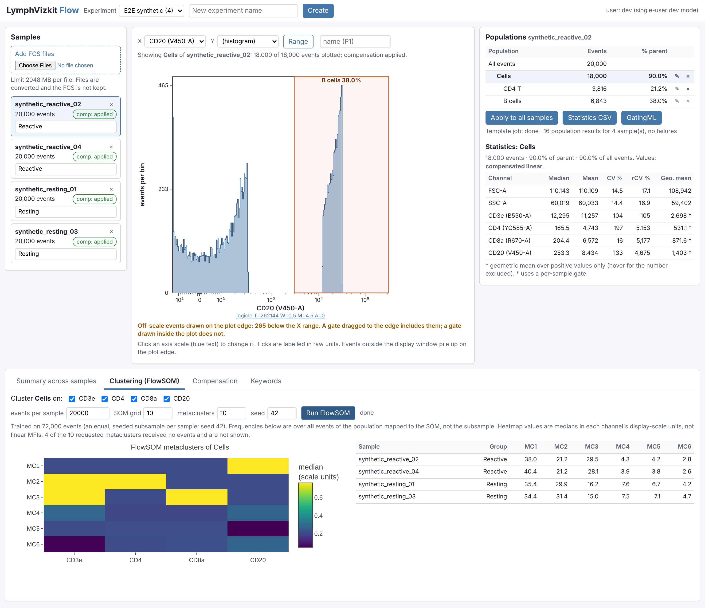

# lymphflow — flow cytometry workbench (prototype)

A self-contained Python service for conventional and pre-unmixed spectral flow cytometry:
FCS upload, compensation, scaling, manual gating, statistics, a gating template applied across
samples, FlowSOM clustering and GatingML export, used through a browser. It is independent of
the Shiny app in `app/`; nothing here is loaded by it.

Why it exists, what it is compared against, and what is and is not verified:
[`docs/omiq_evaluation.md`](../docs/omiq_evaluation.md).



## Quick start

```bash
cd flow
python -m venv .venv && . .venv/bin/activate
pip install -e ".[interop,jobs,dev]"
```

```bash
python -m lymphflow synthetic /tmp/synthetic_fcs
```

```bash
python -m lymphflow serve
```

Open <http://127.0.0.1:8765/>, create an experiment and add the files from `/tmp/synthetic_fcs`
(`truth.json` there lists the exact count of every population in every file).

Python ≥ 3.11. Extras: `interop` (FlowKit: GatingML export, parity tests), `jobs` (FlowSOM),
`dev` (pytest). The core service needs none of them.

## Using it

1. **Create an experiment** and **add FCS files**. Each file is converted to Parquet and deleted.
2. Pick X and Y channels. Choose `(histogram)` for Y to get a 1-D plot.
3. Pick a tool and draw. Rectangle and range: drag. Polygon: click each vertex, then double-click,
   press Enter, or click the first vertex. Esc cancels. Dragging to the plot border extends the
   gate past it, which is how off-scale events (drawn on the border) are included.
4. Click a population in the tree to plot it and see its statistics; new gates are drawn inside it.
5. Click the blue scale text on an axis to change that channel's display scale.
6. **Apply to all samples** evaluates the template for every sample as a background job.
   **Statistics CSV** and **GatingML** export the results and the template.
7. The bottom tabs: summary across samples by group label, FlowSOM, the compensation matrix, and
   the stored keywords.

Set each sample's **group label** in the sample list; the summary plot groups by it. Click a
sample's compensation badge to switch its embedded matrix on or off.

## Configuration

| Variable | Default | Meaning |
|---|---|---|
| `LYMPH_FLOW_DATA` | `<repo>/data/flow` | Writable directory: SQLite file, Parquet events, gate masks, job directories |
| `LYMPH_FLOW_HOST` / `LYMPH_FLOW_PORT` | `127.0.0.1` / `8765` | Listen address |
| `LYMPH_FLOW_AUTH_MODE` | `dev` | `dev`: one local user, loopback only. `proxy`: user name from a header set by the authenticating reverse proxy |
| `LYMPH_FLOW_USER_HEADER` | – | Required with `proxy`: the header carrying the user name |
| `LYMPH_FLOW_URL_PREFIX` | empty | Set (e.g. `/flow`) only if the proxy forwards the prefix instead of stripping it |
| `LYMPH_FLOW_MAX_UPLOAD_MB` | `2048` | Per-file upload limit |
| `LYMPH_FLOW_REGISTER_ROOTS` | empty | `:`-separated directories from which server-side folders may be ingested; empty disables the feature |
| `LYMPH_FLOW_KEEP_ACQ_TIMES` | off | Keep `$DATE`, `$BTIM`, `$ETIM` (dropped by default) |
| `LYMPH_FLOW_CACHE_MB` | `4096` | In-memory cache for columns and masks |
| `LYMPH_FLOW_JOB_PYTHON` | this interpreter | Interpreter used for job subprocesses |

The service refuses to start in `dev` mode on a non-loopback address, and in `proxy` mode without
a header name. `proxy` mode trusts the header, so it is safe only when nothing but the proxy can
reach the port.

## Layout

```
src/lymphflow/
  app.py config.py auth.py state.py snapshot.py    service wiring, settings, identity, repository
  db/                     SQLite access + ordered SQL migrations (metadata only)
  core/fcs_ingest.py      FCS -> Parquet (FlowIO preprocessing, lossless float32 where possible)
  core/deid.py            FCS keyword allow-list
  core/comp.py            spillover parse / classify / apply
  core/scales.py          immutable content-addressed scales, raw-unit ticks, parameter validation
  core/gates.py           gate geometry and membership (GatingML boundary rules)
  core/engine.py          lazy columns, gate tree evaluation, content-addressed mask cache
  core/hist.py stats.py   server-side binning; population statistics on linear values
  api/                    REST routers (experiments, plots, gates, jobs)
  jobs/                   job directories, dispatcher, entry point, steps (apply_template, flowsom)
  interop/gatingml.py     FlowKit-backed GatingML export and the FlowKit -> lymphflow converter
  synthetic.py            FCS files with exactly known populations
  web/                    index.html, ES modules, vendored JS (no CDN, no build step)
tests/unit                synthetic ground truth, API, jobs          (no network)
tests/parity              FlowKit, ISAC truth tables, FlowJo workspace (fetches pinned fixtures)
tests/e2e/smoke.mjs       browser test under a /flow prefix
tests/bench/bench_hist.py latency on a 2-core budget
scripts/                  fetch_fixtures.py, vendor_js.sh, make_synthetic_fcs.py
```

REST documentation is served at `api/docs` while the service runs.

## Background jobs and SLURM

A job is a directory under `<data>/jobs/<id>/` holding `spec.json` (parameters plus a snapshot of
the experiment), `status.json`, `log.txt`, `result.json` and `out/`. The service starts

```bash
python -m lymphflow.jobs.run <jobdir>
```

as a subprocess, one job at a time. A job reads the Parquet event store and writes only inside
its own directory and the mask cache; it never opens SQLite. That command is what an sbatch
script would run (`lymphflow.jobs.spec.sbatch_script` produces one). Submission to SLURM from the
service is **not implemented**, and a job directory copied to another filesystem needs
`LYMPH_FLOW_EVENTS_DIR` / `LYMPH_FLOW_MASKS_DIR` pointed at the event store there.

## Tests

```bash
python -m pytest tests/unit
```

```bash
LYMPH_FLOW_REQUIRE_FIXTURES=1 python -m pytest tests/parity
```

```bash
node tests/e2e/smoke.mjs
```

```bash
taskset -c 0,1 python tests/bench/bench_hist.py
```

The parity suite downloads about 56 MB of public reference files from the FlowKit repository
into `tests/fixtures/` (gitignored) and checks each against a pinned SHA-256 digest. Without
`LYMPH_FLOW_REQUIRE_FIXTURES=1` it skips when the network is unavailable. The browser test needs
Node with the `playwright` package and a Chromium it can launch.

## Licences

This code is MIT, like the rest of the repository. `flowsom` and `igraph` are GPL: they are
optional, imported only inside job processes, and not vendored. The vendored browser libraries
(`web/vendor/`, with licences and a checksum manifest) are Plotly.js (MIT) and htm + Preact
(Apache-2.0, MIT). FlowKit's example data carries no licence statement, so it is downloaded for
tests and never committed.
